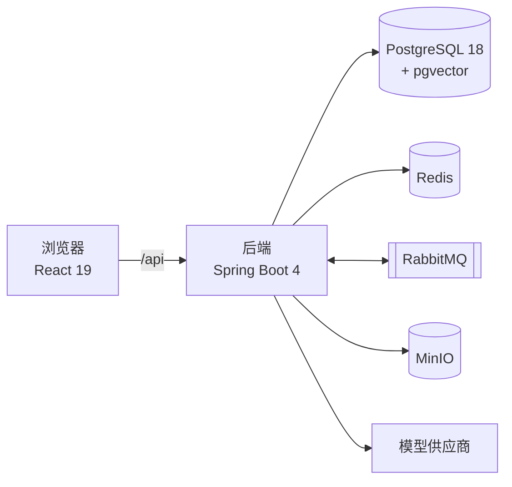

# 问渠 wenqu

面向 5～20 人技术团队的知识库。成员在这里撰写和导入文档，AI 依据团队自己的文档回答问题，并标注每个结论的来源。

> 问渠那得清如许，为有源头活水来。

## 功能

- **文档**：团队空间与成员角色、目录树（拖拽排序、回收站）、块编辑器（自动保存、图片、代码块、表格）。
- **导入**：PDF、Word、Markdown、纯文本导入为文档，后台解析、切块、向量化，显示处理进度，失败自动重试。
- **AI 问答**：按整个空间、文件夹或单篇文档提问，流式回答并用角标标注来源，点击角标查看原文片段并跳转到原文高亮；可停止生成、重新生成、评价回答。没有相关资料时直接说明，不编造。

## 架构



详见 [docs/architecture.md](docs/architecture.md)。

## 本地启动

### 环境要求

| 工具 | 版本 |
|---|---|
| JDK | 21 |
| Node.js | 22 |
| pnpm | 10（`corepack enable` 后自动使用 `package.json` 中声明的版本） |
| Docker | Docker Desktop 或兼容运行时，需处于运行状态 |
| make | macOS / Linux 自带 |

Maven 无需安装，使用仓库内的 `backend/mvnw`。

### 步骤

```bash
git clone <仓库地址> wenqu && cd wenqu
make setup          # 生成 .env、安装前端依赖与 Git 钩子
make deps           # 启动 PostgreSQL、Redis、RabbitMQ、MinIO
make dev-backend    # 终端 1：启动后端
make dev-frontend   # 终端 2：启动前端
```

- 前端：<http://localhost:5173>
- 接口文档（Swagger UI）：<http://localhost:8080/swagger-ui.html>
- 健康检查：<http://localhost:8080/api/system/health>
- RabbitMQ 管理界面：<http://localhost:15672>，MinIO 控制台：<http://localhost:9001>（账号见 `.env`）

端口和数据库账号在 `.env` 中配置；端口被占用时修改 `BACKEND_PORT`、`FRONTEND_PORT`、`DB_PORT`。

### 配置模型

在 `.env` 中填写对话模型和 Embedding 模型，两者都使用 OpenAI 兼容接口，可以来自不同的服务：

```bash
AI_CHAT_BASE_URL=https://api.openai.com/v1
AI_CHAT_API_KEY=...
AI_CHAT_MODEL=gpt-4o-mini
AI_EMBEDDING_BASE_URL=https://api.openai.com/v1
AI_EMBEDDING_API_KEY=...
AI_EMBEDDING_MODEL=text-embedding-3-small
AI_EMBEDDING_DIMENSIONS=1024
```

`AI_EMBEDDING_DIMENSIONS` 必须与模型返回的维度一致，后端启动时会检查。其他参数（检索数量、相似度阈值、切块大小）见 `.env.example`。

### 演示数据

后端启动后执行：

```bash
make demo
```

创建演示账号 `demo@example.test`（密码 `wenqu-demo-2026`，仅用于本地）和「示例团队」空间，导入 [samples/knowledge-base](samples/knowledge-base) 中的 10 篇文档。`make evaluate` 用示例问题评测检索效果，结果见 [docs/evaluation.md](docs/evaluation.md)。

首次编译后端会下载依赖并拉取 PostgreSQL 镜像（jOOQ 代码生成和测试使用 Testcontainers），耗时取决于网络。

### 常用命令

```bash
make help
```

| 命令 | 作用 |
|---|---|
| `make check` | 全部检查：格式、lint、类型检查、架构测试、单元与集成测试 |
| `make fmt` | 自动格式化 |
| `make api` | 后端接口变化后，导出 `backend/openapi.json` 并生成前端接口代码 |
| `make db-reset` | 重置本地数据库 |

## 文档

| 文档 | 内容 |
|---|---|
| [CLAUDE.md](CLAUDE.md) | AI 开发规则入口 |
| [docs/architecture.md](docs/architecture.md) | 整体架构 |
| [docs/conventions/](docs/conventions/) | 开发规范：文档、代码、接口、数据库、Git |
| [docs/modules/](docs/modules/) | 各模块设计 |
| [docs/evaluation.md](docs/evaluation.md) | 检索评测 |
| [docs/_decisions/](docs/_decisions/) | 技术决策记录 |
