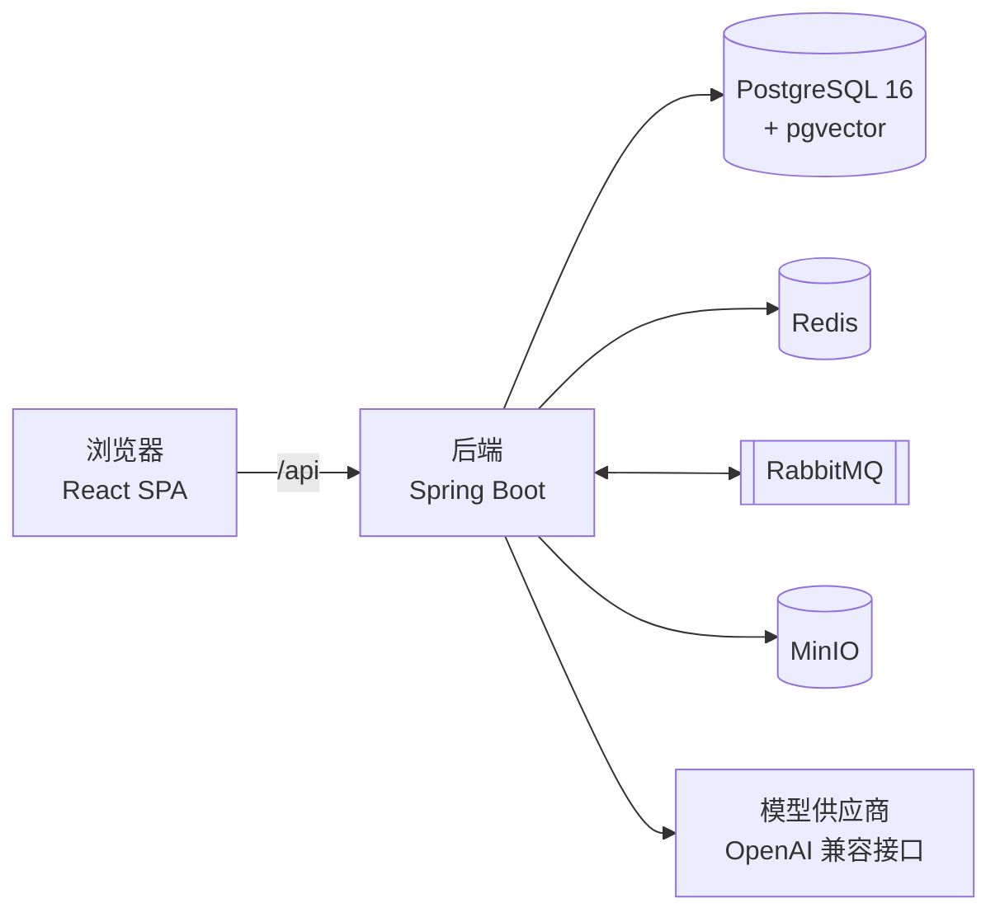
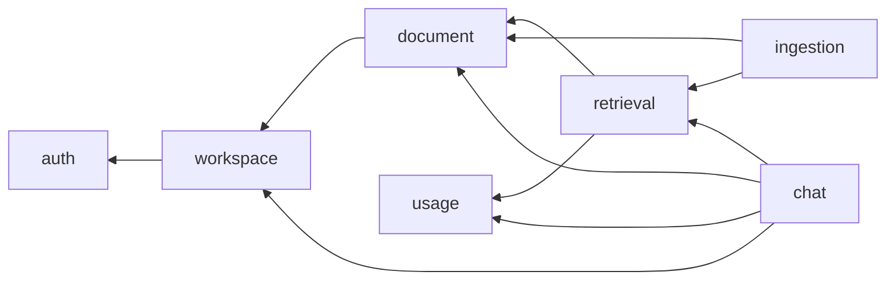
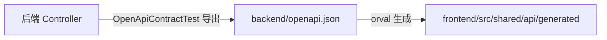

# 整体架构

## 系统组成



| 组件                  | 作用                                                                                                    |
| --------------------- | ------------------------------------------------------------------------------------------------------- |
| 前端                  | React 单页应用，开发时由 Vite 把`/api` 代理到后端                                                     |
| 后端                  | 单个 Spring Boot 应用，内部按业务领域划分模块                                                           |
| PostgreSQL + pgvector | 业务数据与向量存储在同一个库，见[0001](_decisions/0001-向量存储选择pgvector.md)                          |
| Redis                 | 缓存与限流                                                                                              |
| RabbitMQ              | 异步任务：文档解析、向量化、重新索引                                                                    |
| MinIO                 | 文件存储（S3 兼容），文件通过有时效的签名链接访问                                                       |
| 模型供应商            | 对话模型与 Embedding 模型，通过配置切换，见[0004](_decisions/0004-AI接入使用SpringAI与OpenAI兼容接口.md) |

本地依赖由根目录 `docker-compose.yml` 启动。

## 技术基线

| 层      | 选型                                                                                                 |
| ------- | ---------------------------------------------------------------------------------------------------- |
| 后端    | Java 21、Spring Boot 4.1、Spring Security、jOOQ 3.21、Flyway、springdoc-openapi 3                    |
| AI 接入 | Spring AI 2.0                                                                                        |
| 前端    | React 19、TypeScript 6、Vite 8、TanStack Query 5、Zustand 5、React Router、Tailwind CSS 4、shadcn/ui |
| 编辑器  | Tiptap 3                                                                                             |
| 测试    | JUnit 5、ArchUnit、Testcontainers 2；Vitest、Testing Library                                         |
| 构建    | Maven（`mvnw`）；pnpm workspace                                                                    |

版本选择见 [0007](_decisions/0007-采用SpringBoot4与React19基线.md)，持久层选择见 [0003](_decisions/0003-持久层使用jOOQ.md)。

## 后端模块

包结构为 `com.wenqu.<模块>`。

| 模块          | 职责                                                                 | 拥有的数据                               |
| ------------- | -------------------------------------------------------------------- | ---------------------------------------- |
| `auth`      | 注册、登录、JWT 签发与刷新、Spring Security 配置                     | 用户、Refresh Token                      |
| `workspace` | 团队空间、成员、邀请、空间级角色与鉴权判断                           | 空间、成员关系、邀请链接                 |
| `document`  | 目录树、文档内容、回收站、搜索、节点级权限                           | 目录节点、文档内容、评论、版本、节点 ACL |
| `retrieval` | 文本块的向量化写入与检索                                             | 文本块与向量                             |
| `ingestion` | 文件导入、解析、切块、索引任务调度                                   | 导入文件、索引任务                       |
| `chat`      | AI 问答、会话、引用、反馈                                            | 会话、消息、引用、反馈                   |
| `usage`     | 模型调用计量、额度、限流                                             | 用量记录、额度                           |
| `infra`     | 技术能力：模型客户端、对象存储、消息队列、事务性发件箱、系统健康检查 | 发件箱                                   |
| `common`    | 统一响应、错误码、异常处理等与业务无关的基础类型                     | 无                                       |

### 依赖方向



- 箭头表示「依赖」。依赖是单向的，不存在循环。
- 所有业务模块都可以依赖 `infra` 和 `common`；`infra` 只依赖 `common`；`common` 不依赖任何模块。
- 下游模块需要通知上游时（例如文档被删除后 `retrieval` 删除文本块），由上游发布领域事件、下游订阅，不反向调用。

### 模块之间的交互

**同步调用**：模块 A 只能调用模块 B 的 `api` 包中的接口和 DTO，不能访问 B 的 `service`、`repository`、`domain`、`controller`，也不能读写 B 的表。

**异步事件**：模块在自己的数据库事务中把事件写入发件箱表，由发件箱转发器在事务提交后投递到 RabbitMQ，订阅方消费处理。业务写入与事件要么都成功、要么都失败，服务崩溃不会丢事件。消费者按「至少一次」投递设计，处理必须幂等。见 [0006](_decisions/0006-跨模块事件使用事务性发件箱.md)。

### 模块内部分层

```
com.wenqu.<模块>
├── api/          对外暴露的服务接口、DTO、领域事件（其他模块唯一可见的部分）
├── controller/   HTTP 接口，以及接口专用的 XxxRequest / XxxResponse
├── service/      业务逻辑，实现 api 中的接口
├── repository/   数据访问，唯一可以使用 jOOQ 生成类的地方
└── domain/       领域对象，不依赖 Spring 和 jOOQ
```

调用方向：`controller → service → repository`，不允许跨层或反向调用。

## 数据

- 单个 PostgreSQL 库，**每个模块一个 schema**，schema 名与模块名相同，见 [0005](_decisions/0005-每个模块独立schema.md)。
- jOOQ 生成代码的包名为 `com.wenqu.jooq.<schema>`，只有所属模块的 `repository` 可以引用。
- 跨模块查询不做 join。需要按文档、空间过滤的表冗余存储 `workspace_id`、`document_id`，过滤条件由上游模块的 `api` 提供。
- 表结构变更只通过 Flyway 迁移脚本，规则见 [database.md](conventions/database.md)。

## 前端结构

```
frontend/src/
├── app/          应用入口：路由、Provider、页面组装
├── features/     按业务领域划分，与后端模块对应
│   └── <feature>/index.ts   该 feature 唯一对外入口
└── shared/       通用组件（ui/）、工具（lib/）、接口客户端（api/）
```

- `features/` 之间只能通过对方的 `index.ts` 引用，不能引用内部文件。
- `shared/` 不依赖 `features/` 和 `app/`。
- 服务端状态由 TanStack Query 管理，客户端状态由 Zustand 管理。

## 接口契约



- `backend/openapi.json` 是前后端之间的契约，提交到仓库。后端接口变化时必须同步更新该文件，否则 `OpenApiContractTest` 失败。
- 前端从该文件生成类型和 TanStack Query hooks，生成代码不入库，在 `pnpm install` 和 `make api` 时生成。
- 接口格式见 [api.md](conventions/api.md)。

## 架构规则的自动检查

| 规则                                         | 检查                               |
| -------------------------------------------- | ---------------------------------- |
| 跨模块只能访问`api` 包                     | ArchUnit                           |
| 分层调用方向                                 | ArchUnit                           |
| 模块间无循环依赖                             | ArchUnit                           |
| jOOQ 表类只能由所属模块的`repository` 访问 | ArchUnit                           |
| `api` 包不引用本模块内部类                 | ArchUnit                           |
| `domain` 不依赖 Spring 和 jOOQ             | ArchUnit                           |
| 前端 feature 边界                            | ESLint`eslint-plugin-boundaries` |
| 接口契约一致                                 | `OpenApiContractTest`            |
