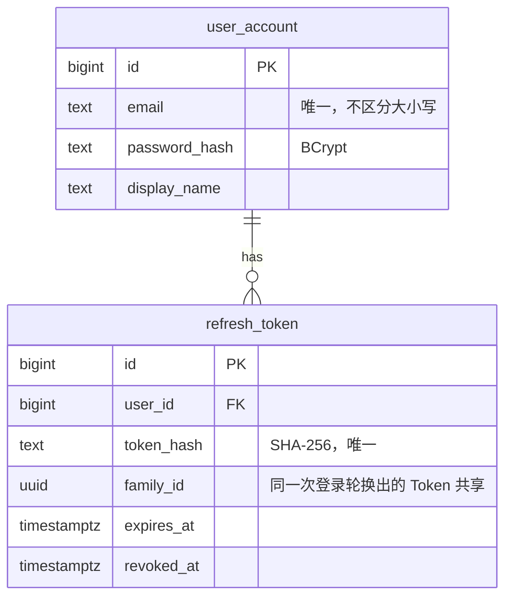
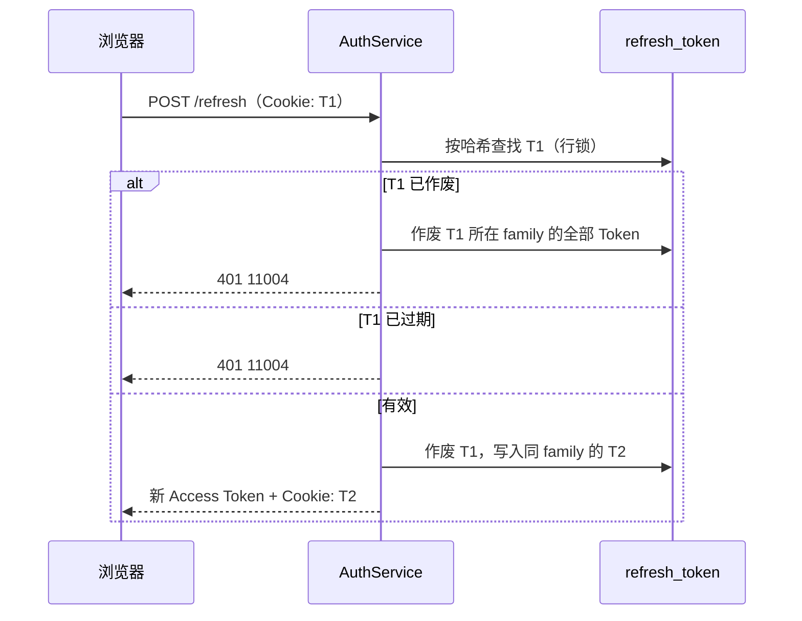

# auth 模块

## 职责

- 邮箱 + 密码注册、登录、退出。
- 签发与校验 Access Token（JWT），轮换 Refresh Token。
- Spring Security 配置：除公开接口外，所有请求必须携带有效的 Access Token。
- 向其他模块提供当前用户和用户信息查询。

不负责空间与角色，见 [workspace](workspace.md)。

## 数据模型

| 索引 | 服务的查询 |
|---|---|
| `uk_user_account_email (lower(email))` | 注册查重、登录按邮箱查找 |
| `uk_refresh_token_token_hash` | 刷新、退出时按 Token 查找 |
| `idx_refresh_token_family_id` | 作废整个 family |

## 对外接口

### HTTP 接口

| 方法 | 路径 | 说明 | 登录 |
|---|---|---|---|
| POST | `/api/auth/register` | 注册并登录 | 否 |
| POST | `/api/auth/login` | 登录 | 否 |
| POST | `/api/auth/refresh` | 用 Cookie 中的 Refresh Token 换取新令牌 | 否 |
| POST | `/api/auth/logout` | 作废 Refresh Token 并清除 Cookie | 否 |
| GET | `/api/auth/me` | 当前用户 | 是 |

登录、注册、刷新的响应体包含 `accessToken`、`accessTokenExpiresAt`、`user`；Refresh Token 只通过 Cookie 下发：

| Cookie 属性 | 值 |
|---|---|
| 名称 | `wenqu_refresh` |
| `HttpOnly` | 是，脚本无法读取 |
| `SameSite` | `Strict`，跨站请求不携带 |
| `Path` | `/api/auth`，只发往认证接口 |
| `Secure` | 由 `AUTH_COOKIE_SECURE` 控制，HTTPS 部署时开启 |

错误码：

| 错误码 | HTTP | 场景 | 前端处理 |
|---|---|---|---|
| 11001 | 409 | 邮箱已注册 | 提示 |
| 11002 | 401 | 邮箱或密码错误（两种情况提示相同） | 提示 |
| 11003 | 401 | 未携带、无效或过期的 Access Token | 自动刷新后重试 |
| 11004 | 401 | Refresh Token 无效、过期、已作废 | 跳转登录页 |

### 模块 API（`com.wenqu.auth.api`）

| 类型 | 说明 |
|---|---|
| `CurrentUser` | 当前用户。controller 方法声明该类型参数即可获得，不出现在接口文档中 |
| `CurrentUserContext` | 在拦截器等非 controller 场景获取当前用户 |
| `UserApi.findByIds` | 按 id 批量查询 `UserSummary`（id、邮箱、昵称） |

## 核心流程

### 令牌

- Access Token：HS256 签名的 JWT，`sub` 为用户 id，有效期 `ACCESS_TOKEN_TTL`（默认 2 小时）。服务端不保存，无法提前作废。
- Refresh Token：32 字节随机数，数据库只保存 SHA-256 哈希，有效期 `REFRESH_TOKEN_TTL`（默认 7 天），每次刷新后重新计算。

### 刷新与重用检测

已作废的 Token 再次出现，说明它可能被窃取后使用。作废整个 family 后，攻击者和用户都需要重新登录。

### 登录

- 邮箱不存在时同样执行一次 BCrypt 校验，使响应时间与密码错误一致，避免据此探测邮箱是否注册。
- 注册依赖 `lower(email)` 唯一索引判重（`insert ... on conflict do nothing`），并发注册同一邮箱只有一个成功。
- 密码长度 8～72 位（BCrypt 只使用前 72 字节）。

### 前端

- Access Token 只保存在内存中（Zustand），不写入 localStorage。页面加载时调用刷新接口恢复登录状态。
- 请求返回 11003 时自动刷新并重试原请求；同一时刻只发起一次刷新，跨标签页通过 Web Locks 串行，避免两个标签页同时使用同一个 Refresh Token 触发重用检测。
- 刷新失败（11004）时清除登录状态，跳转 `/login?redirect=<原路径>`。

## 依赖

| 依赖 | 用途 |
|---|---|
| PostgreSQL | 用户与 Refresh Token |
| `JWT_SECRET` | JWT 签名密钥，至少 32 字符 |
