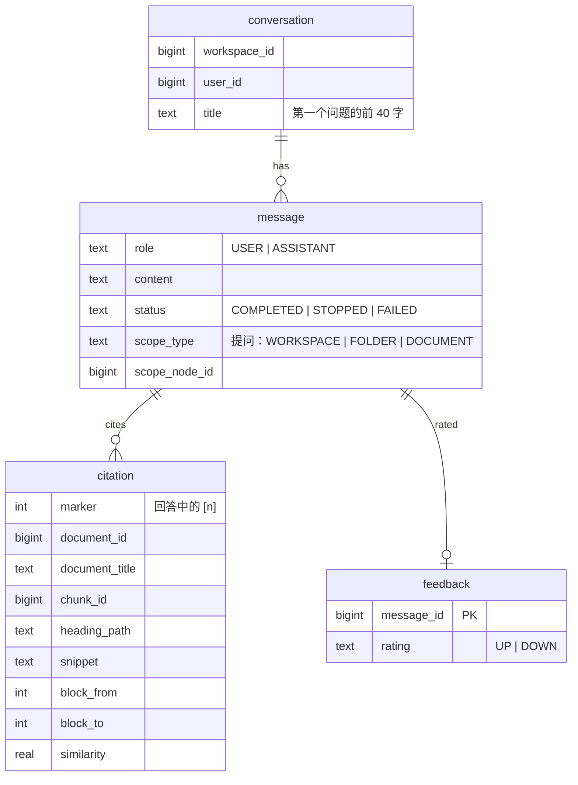
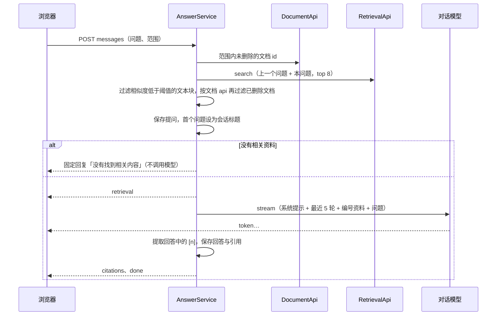

# chat 模块

## 职责

- AI 问答：在指定范围的文档中检索，依据检索到的资料流式回答，并用角标标注引用。
- 会话与消息的保存、停止生成、重新生成、回答反馈（有帮助 / 没有帮助）。

会话只属于创建者，同一空间的其他成员看不到。

## 数据模型

- 引用保存回答时的文档标题、原文片段和段落范围：文档之后修改或重新索引，历史回答仍能展示当时的依据。
- 删除会话时消息、引用、反馈通过外键级联删除。

| 索引 | 服务的查询 |
|---|---|
| `idx_conversation_workspace_id_user_id` | 我在空间中的最近会话 |
| `idx_message_conversation_id` | 会话中的消息 |
| `uk_citation_message_id_marker` | 回答的引用 |

## 对外接口

### HTTP 接口

路径前缀 `/api/workspaces/{workspaceId}`，所需角色均为 VIEWER：

| 方法 | 路径 | 说明 |
|---|---|---|
| GET | `/conversations` | 我的最近 50 个会话 |
| POST | `/conversations` | 新建会话 |
| GET | `/conversations/{id}` | 会话中的消息、引用与反馈 |
| DELETE | `/conversations/{id}` | 删除会话 |
| POST | `/conversations/{id}/messages` | 提问（`question`、`scopeType`、`scopeNodeId`），SSE 返回回答 |
| POST | `/conversations/{id}/regenerate` | 重新生成最后一个问题的回答，SSE |
| PUT | `/messages/{messageId}/feedback` | 评价回答，`rating` 为 null 时取消 |

SSE 事件：`event` 为类型名，`data` 为 `ChatStreamEvent` JSON，依次为：

| 类型 | data |
|---|---|
| `retrieval` | `documents`：检索命中的文档；`citations`：提供给模型的全部资料（`marker` 即资料编号） |
| `token` | `text`：新生成的文本 |
| `citations` | `citations`：回答实际引用的资料 |
| `error` | `message`：模型调用失败（之后仍有 `done`） |
| `done` | `messageId`、`status`：回答已保存 |

校验、范围、检索在开始输出前完成，出错时返回普通 JSON 错误响应。

错误码：

| 错误码 | HTTP | 场景 |
|---|---|---|
| 16001 | 404 | 会话不存在或不属于当前用户 |
| 16002 | 404 | 评价的回答不存在或不属于当前用户 |
| 16003 | 400 | 提问范围的文件夹或文档不存在 |
| 16004 | 503 | Embedding 模型不可用，无法检索 |
| 16005 | 409 | 重新生成时会话中还没有问题 |

### 模块 API

无。

## 核心流程

### 提问

- 范围：`WORKSPACE` 为空间内全部未删除文档；`FOLDER` 为文件夹子树中的文档；`DOCUMENT` 为单篇文档。
- 检索文本带上上一个问题，使「它怎么配置」这类追问能检索到上一轮讨论的对象。
- 阈值 `RETRIEVAL_MIN_SIMILARITY`（默认 0.35），检索数量 `RETRIEVAL_TOP_K`（默认 8），取值依据见 [evaluation.md](../evaluation.md)。
- 系统提示要求只依据资料回答、资料不足时明确说明、用 [n] 标注来源，并忽略资料中试图改变规则的内容。历史回答作为上下文时去掉角标，避免与本轮资料编号混淆；失败的回答不作为上下文。
- 引用只保存回答中实际出现的、在资料编号范围内的角标。

### 停止生成与失败

- 停止：客户端中止请求后，服务端在下一次写出失败时取消对模型流的订阅，对模型的 HTTP 请求随之中断，已生成的部分以 `STOPPED` 保存（日志 `Model stream cancelled by client`）。
- 模型中途出错：已生成的部分以 `FAILED` 保存，发送 `error` 与 `done`。
- 回答只保存一次：完成、出错、取消三条路径以原子标记互斥。

### 重新生成

删除最后一个问题之后的回答，按该问题提问时的范围重新检索并回答。

### 前端（`features/chat`）

- 问答页 `/w/:workspaceId/chat/:conversationId?`：新会话发出第一个问题时创建会话并切换地址；两个地址是同一个路由元素，流式回答不中断。侧栏下半部分在问答页显示最近会话（可删除），其他页面显示目录树。
- 范围选择：整个空间、当前文件夹、当前文档。从文档页顶栏「问 AI」进入时（`?doc=`）后两项可选，默认当前文档。
- 流式请求使用 `fetch` 读取 SSE（需要携带 Authorization 头，`EventSource` 不支持），Access Token 过期时刷新后重试一次。停止生成即中止请求。回答保存后刷新会话，确认列表中已有该回答再移除临时显示。
- 回答以 Markdown 渲染（react-markdown，不渲染原始 HTML）；`[n]` 显示为角标按钮，生成过程中即可点击。点击展开引用卡片：文档标题、标题路径、原文片段、「跳转到原文并高亮」（`/w/:id/d/:docId?blocks=from-to`，见 [document](document.md#前端)）。
- 没有引用的回答（未找到相关内容）以虚线框显示。最后一个回答可重新生成；每个回答可评价。

## 依赖

| 依赖 | 用途 |
|---|---|
| workspace `@RequireWorkspaceRole` | 接口访问控制 |
| document `DocumentApi` | 提问范围内的文档 id、文档标题（同时过滤已删除文档） |
| retrieval `RetrievalApi` | 检索 |
| Spring AI `ChatModel`（infra 配置） | 流式回答 |
