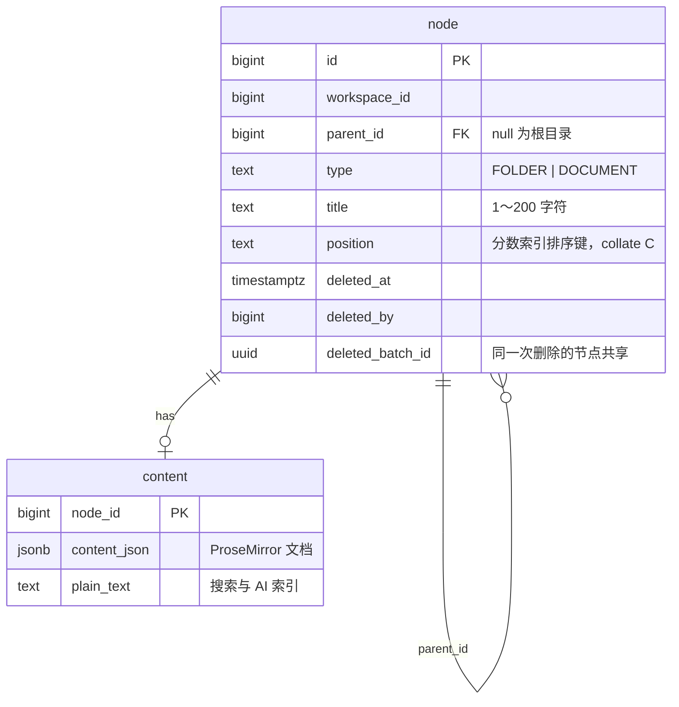
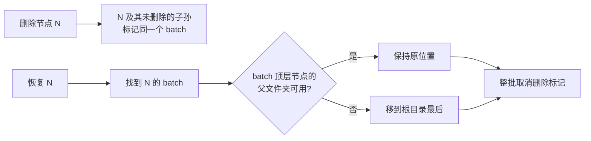

# document 模块

## 职责

- 空间内的目录树：文件夹与文档的新建、重命名、排序、移动。
- 回收站：删除进入回收站，保留 30 天，可恢复，到期彻底删除。
- 按标题和正文搜索。
- 文档内容（ProseMirror JSON 与纯文本）的存储。

## 数据模型

- 只有 `DOCUMENT` 节点有 `content` 行，随节点一起创建。
- `deleted_at` 与 `deleted_batch_id` 同时为空或同时非空（检查约束）。
- 彻底删除节点时，子节点与正文通过外键级联删除。

| 索引 | 服务的查询 |
|---|---|
| `idx_node_workspace_id`（部分索引：未删除） | 加载目录树 |
| `idx_node_parent_id` | 查询同级节点、外键 |
| `idx_node_deleted_batch_id`（部分索引：已删除） | 回收站列表、恢复、清理 |
| `idx_node_title_trgm`、`idx_content_plain_text_trgm`（GIN trigram） | `ILIKE '%关键词%'` 模糊搜索 |

trigram 索引对少于 3 个字符的关键词无法缩小范围，此时退化为扫描该空间的节点；团队规模下可以接受。

## 对外接口

### HTTP 接口

路径前缀 `/api/workspaces/{workspaceId}`：

| 方法 | 路径 | 说明 | 所需角色 |
|---|---|---|---|
| GET | `/nodes` | 全部未删除节点的扁平列表，前端组装成树 | VIEWER |
| POST | `/nodes` | 新建（`parentId`、`type`、`title`），排在目标文件夹最后 | EDITOR |
| PATCH | `/nodes/{nodeId}` | 重命名 | EDITOR |
| POST | `/nodes/{nodeId}/move` | 移动到 `parentId` 中 `afterNodeId` 之后（null 为最前） | EDITOR |
| DELETE | `/nodes/{nodeId}` | 移入回收站，子孙一并移入 | EDITOR |
| GET | `/trash` | 回收站：每次删除的顶层节点、下级数量、彻底删除时间 | VIEWER |
| POST | `/trash/{nodeId}/restore` | 恢复整个删除批次 | EDITOR |
| GET | `/search?q=` | 按标题和正文搜索，标题命中优先，最多 20 条 | VIEWER |

错误码：

| 错误码 | HTTP | 场景 |
|---|---|---|
| 13001 | 404 | 节点不存在、已删除或不属于该空间 |
| 13002 | 400 | 目标父节点不是该空间中未删除的文件夹 |
| 13003 | 400 | 把节点移动到自身或其子孙中 |
| 13004 | 400 | `afterNodeId` 不是目标文件夹中的节点 |
| 13005 | 404 | 回收站中没有该项 |

### 模块 API

无。

## 核心流程

### 排序：分数索引

同级节点按 `position` 字符串升序排列（`collate "C"`，按字节比较）。插入或移动时，在前后两个相邻节点的键之间生成新键（`FractionalIndex.between`，移植自 rocicorp/fractional-indexing），只修改被移动的节点。连续追加到末尾时键长增长缓慢（追加 1 万次后不超过 5 个字符）。

前端拖拽时用同一算法（npm `fractional-indexing`）立即更新本地缓存，最终位置以服务端返回为准；请求失败时提示并重新加载目录树。

### 结构变更的并发控制

创建、移动、删除、恢复在事务开始时获取空间级事务锁（`pg_advisory_xact_lock(workspaceId)`），同一空间的结构变更串行执行：

- 环检测（目标文件夹是否是被移动节点的子孙，递归 CTE 向上查找祖先）与更新之间不会被其他移动插入。两个请求同时执行「A 移入 B」和「B 移入 A」时，只有一个成功。
- 计算排序键时读取的相邻节点不会被并发修改，不会生成相同的键。

### 删除与恢复

- 先单独删除的子节点属于更早的批次，恢复父文件夹时不会一起恢复。
- `TrashPurgeJob` 每天 03:00 彻底删除 `deleted_at` 早于 30 天前的节点。

### 前端

| 路由 | 页面 |
|---|---|
| `/w/:workspaceId`（左侧栏） | 目录树、搜索、新建、回收站入口 |
| `/w/:workspaceId/d/:nodeId` | 文档页（路径与标题） |
| `/w/:workspaceId/trash` | 回收站 |

- 目录树使用 `@headless-tree/react` 与 `@tanstack/react-virtual`：只渲染可见行。生产构建下 500 个节点全部展开时，每次展开平均 4.8ms（P95 10.2ms），无超过 50ms 的长任务。
- 拖拽：放在行的上下边缘为同级排序，放在文件夹中间为移入；前端同样禁止把文件夹拖进自身或子孙。
- 搜索对话框快捷键 Ctrl/Cmd + P，输入停顿 250ms 后请求。
- 目录树由 `app` 层通过插槽放入 workspace 的页面框架，workspace 前端模块不依赖 document。

## 依赖

| 依赖 | 用途 |
|---|---|
| workspace `@RequireWorkspaceRole` | 接口访问控制 |
| auth `UserApi` | 回收站中删除人的昵称 |
| PostgreSQL `pg_trgm` 扩展 | 模糊搜索索引 |
