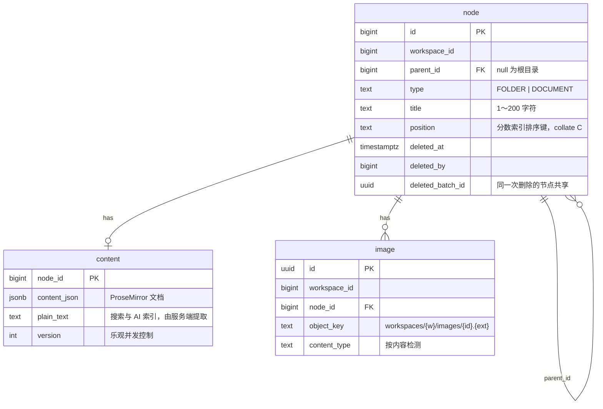
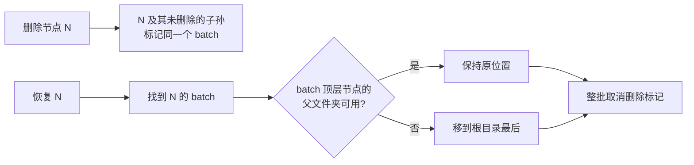
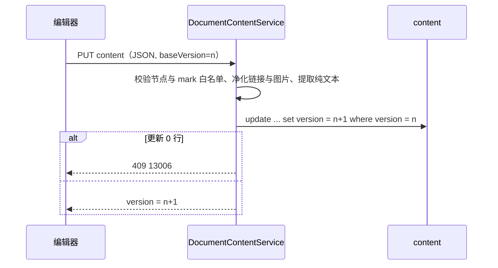

# document 模块

## 职责

- 空间内的目录树：文件夹与文档的新建、重命名、排序、移动。
- 回收站：删除进入回收站，保留 30 天，可恢复，到期彻底删除。
- 按标题和正文搜索。
- 文档正文：ProseMirror JSON 的保存（服务端净化）与纯文本提取，乐观并发控制。
- 文档中的图片：上传到对象存储，通过有时效的签名链接访问。

## 数据模型

- 只有 `DOCUMENT` 节点有 `content` 行，随节点一起创建。
- `deleted_at` 与 `deleted_batch_id` 同时为空或同时非空（检查约束）。
- 彻底删除节点时，子节点与正文通过外键级联删除。

| 索引 | 服务的查询 |
|---|---|
| `idx_node_workspace_id`（部分索引：未删除） | 加载目录树 |
| `idx_node_parent_id` | 查询同级节点、外键 |
| `idx_node_deleted_batch_id`（部分索引：已删除） | 回收站列表、恢复、清理 |
| `idx_node_title_trgm`、`idx_content_plain_text_trgm`（GIN trigram） | `ILIKE '%关键词%'` 模糊搜索 |
| `idx_image_node_id` | 外键；清理回收站时查找图片对象 |

trigram 索引对少于 3 个字符的关键词无法缩小范围，此时退化为扫描该空间的节点；团队规模下可以接受。

## 对外接口

### HTTP 接口

路径前缀 `/api/workspaces/{workspaceId}`：

| 方法 | 路径 | 说明 | 所需角色 |
|---|---|---|---|
| GET | `/nodes` | 全部未删除节点的扁平列表，前端组装成树 | VIEWER |
| POST | `/nodes` | 新建（`parentId`、`type`、`title`），排在目标文件夹最后 | EDITOR |
| PATCH | `/nodes/{nodeId}` | 重命名 | EDITOR |
| POST | `/nodes/{nodeId}/move` | 移动到 `parentId` 中 `afterNodeId` 之后（null 为最前） | EDITOR |
| DELETE | `/nodes/{nodeId}` | 移入回收站，子孙一并移入 | EDITOR |
| GET | `/trash` | 回收站：每次删除的顶层节点、下级数量、彻底删除时间 | VIEWER |
| POST | `/trash/{nodeId}/restore` | 恢复整个删除批次 | EDITOR |
| GET | `/search?q=` | 按标题和正文搜索，标题命中优先，最多 20 条 | VIEWER |
| GET | `/documents/{nodeId}` | 标题、正文 JSON、版本、最后编辑人与时间 | VIEWER |
| PUT | `/documents/{nodeId}/content` | 保存正文（`content`、`baseVersion`），版本不一致返回 409 | EDITOR |
| POST | `/documents/{nodeId}/images` | 上传图片（multipart `file`），返回 `imageId` | EDITOR |
| GET | `/images/{imageId}/url` | 图片签名链接，1 小时有效 | VIEWER |

错误码：

| 错误码 | HTTP | 场景 |
|---|---|---|
| 13001 | 404 | 节点不存在、已删除或不属于该空间 |
| 13002 | 400 | 目标父节点不是该空间中未删除的文件夹 |
| 13003 | 400 | 把节点移动到自身或其子孙中 |
| 13004 | 400 | `afterNodeId` 不是目标文件夹中的节点 |
| 13005 | 404 | 回收站中没有该项 |
| 13006 | 409 | 保存正文时版本已变化（其他标签页或成员已保存） |
| 13007 | 400 | 正文结构不合法（未知节点或格式类型） |
| 13008 | 413 | 正文 JSON 超过 2MB |
| 13009 | 415 | 图片类型不是 PNG、JPEG、GIF、WebP（按内容检测） |
| 13011 | 404 | 图片不存在或不属于该空间 |

### 模块 API（`com.wenqu.document.api`）

`DocumentApi`，供 ingestion、chat 使用，调用方负责角色校验：

| 方法 | 说明 |
|---|---|
| `createDocument(workspaceId, parentId, title, userId)` | 在文件夹最后新建空文档（导入文件） |
| `replaceContent(workspaceId, documentId, blocks, userId)` | 用导入内容（`ImportedBlock`）整体替换正文，不做版本校验，返回新版本；不发布 `DocumentContentChangedEvent` |
| `findSnapshot(workspaceId, documentId)` | 未删除文档的标题、版本与顶层块（`DocumentBlock`：位置、类型、标题级别、纯文本） |
| `findActiveDocumentIds(workspaceId, folderId)` | 未删除的文档 id：整个空间或文件夹子树 |
| `findActiveDocuments(workspaceId, ids)` | ids 中未删除的文档：标题与所在文件夹路径 |

发布的事件（经 [发件箱](infra.md#事务性发件箱)）：

| 路由键 | 事件 | 时机 |
|---|---|---|
| `document.content-changed` | `DocumentContentChangedEvent(workspaceId, documentId, userId)` | 编辑器保存正文；同一文档停止编辑 30 秒后才投递（防抖） |
| `document.purged` | `DocumentsPurgedEvent(documentIds)` | 回收站清理彻底删除文档，每个事件最多 1000 个 id |

移入回收站和恢复不发布事件：下游按 `findActiveDocumentIds`、`findActiveDocuments` 过滤已删除的文档。

## 核心流程

### 排序：分数索引

同级节点按 `position` 字符串升序排列（`collate "C"`，按字节比较）。插入或移动时，在前后两个相邻节点的键之间生成新键（`FractionalIndex.between`，移植自 rocicorp/fractional-indexing），只修改被移动的节点。连续追加到末尾时键长增长缓慢（追加 1 万次后不超过 5 个字符）。

前端拖拽时用同一算法（npm `fractional-indexing`）立即更新本地缓存，最终位置以服务端返回为准；请求失败时提示并重新加载目录树。

### 结构变更的并发控制

创建、移动、删除、恢复在事务开始时获取空间级事务锁（`pg_advisory_xact_lock(workspaceId)`），同一空间的结构变更串行执行：

- 环检测（目标文件夹是否是被移动节点的子孙，递归 CTE 向上查找祖先）与更新之间不会被其他移动插入。两个请求同时执行「A 移入 B」和「B 移入 A」时，只有一个成功。
- 计算排序键时读取的相邻节点不会被并发修改，不会生成相同的键。

### 删除与恢复

- 先单独删除的子节点属于更早的批次，恢复父文件夹时不会一起恢复。
- `TrashPurgeJob` 每天 03:00 彻底删除 `deleted_at` 早于 30 天前的节点，并在同一事务中发布 `document.purged`。

### 正文保存

服务端净化规则（`ProseMirrorContent`），与前端编辑器 schema 一致：

- 节点类型白名单：段落、一至三级标题、有序/无序/任务列表、代码块、引用、提示框、分割线、图片、表格；mark 白名单：粗体、斜体、删除线、行内代码、下划线、链接。出现其他类型返回 13007。
- 每种节点只保留白名单内的属性（如标题只保留 `level` 并限制在 1～3），丢弃 `style`、事件属性等。
- 链接只允许 `http:`、`https:`、`mailto:` 和站内路径，其他链接（如 `javascript:`）去掉链接保留文字。
- 图片节点只保存 `imageId`，且必须是本空间上传过的图片，否则删除该节点。
- 纯文本由服务端从净化后的 JSON 提取，块级节点之间换行，不信任前端提交的文本。
- 保存成功后在同一事务中写入防抖的 `document.content-changed` 事件。

### 导入内容

`ProseMirrorContent.fromImported` 把导入文件解析出的块转换为文档 JSON：标题级别超过 3 的按 3 级处理，连续的同类列表项合并为一个列表，段落内的换行保留为硬换行，空白块丢弃；结果再经过同一套净化。

### 图片

- 上传时用 Apache Tika 按文件内容检测类型，不信任扩展名与请求头；限制 10MB。
- 对象存储中的对象不公开。正文只存 `imageId`，前端显示时调用 `/images/{imageId}/url` 获取签名链接（`` 请求无法携带 Access Token，因此不使用需要鉴权的固定地址）。
- 清理回收站时，先在事务中删除节点（图片记录随之级联删除），提交后再删除对象存储中的文件。

### 前端

| 路由 | 页面 |
|---|---|
| `/w/:workspaceId` | 空间首页：最近编辑的 10 篇文档 |
| `/w/:workspaceId`（左侧栏） | 搜索入口、回收站导航、「文档」目录树与新建菜单，由应用层放入 workspace 的页面框架 |
| `/w/:workspaceId/d/:nodeId` | 文档页：顶栏为路径、其他模块的操作（下载原文件、问 AI）、保存状态、更多操作（移到回收站）；正文区为标题、最后编辑人与时间、编辑器 |
| `/w/:workspaceId/trash` | 回收站 |

- 目录树使用 `@headless-tree/react` 与 `@tanstack/react-virtual`：只渲染可见行。生产构建下 500 个节点全部展开时，每次展开平均 4.8ms（P95 10.2ms），无超过 50ms 的长任务。
- 拖拽：放在行的上下边缘为同级排序，放在文件夹中间为移入；前端同样禁止把文件夹拖进自身或子孙。
- 搜索对话框快捷键 Ctrl/Cmd + K，输入停顿 250ms 后请求。
- 目录树由 `app` 层通过插槽放入 workspace 的页面框架，workspace 前端模块不依赖 document。目录树行末的索引状态（`renderBadge`）和文档页顶栏的附加操作（`headerActions`）同样由 `app` 层传入，document 前端模块不依赖 ingestion、chat。
- 文档页链接带 `blocks=3-5` 时（AI 回答的引用跳转），`BlockHighlight` 扩展以装饰高亮第 3～5 个顶层块并滚动到第一个块；高亮不修改文档，用户开始编辑后消失。

#### 编辑器

- 基于 Tiptap 3：一至三级标题、有序/无序/任务列表、代码块（lowlight 语法高亮）、表格、图片、引用、提示框；StarterKit 自带 Markdown 快捷输入（`## `、`- `、`[ ] `、`> `、三个反引号）。
- 输入 `/` 弹出插入菜单，支持中文标题、英文与拼音首字母过滤，上下键选择、回车确认。
- 粘贴或拖入图片文件时自动上传并插入；粘贴 HTML 由编辑器 schema 解析，`script`、`iframe`、事件属性、外部图片和不安全链接被丢弃（`sanitize.test.ts`）。
- 只读成员的编辑器不可编辑，不触发保存。

#### 自动保存（`AutoSaver`）

| 场景 | 行为 |
|---|---|
| 停止输入 1.5 秒 | 保存，状态「保存中」→「已保存」 |
| 保存期间继续输入 | 当前请求完成后基于新版本再保存 |
| 网络失败 | 状态「保存失败」，按 2、4、8、16、30 秒退避重试；浏览器 `online` 事件时立即重试 |
| 版本冲突 | 停止重试，提示刷新获取最新内容 |
| 切换到其他页面 | 未保存内容以快照形式继续在后台保存，直到成功 |
| 刷新或关闭页面 | `pagehide` 时用 `fetch keepalive` 提交未保存内容；超过 keepalive 大小限制时由 `beforeunload` 提示 |

文档页加载正文后不再自动重新获取（`staleTime: Infinity`），避免覆盖本地编辑；空间信息的后台刷新失败时保留已有数据，不卸载编辑器。

## 依赖

| 依赖 | 用途 |
|---|---|
| workspace `@RequireWorkspaceRole` | 接口访问控制 |
| auth `UserApi` | 回收站中删除人的昵称 |
| infra `OutboxPublisher` | 发布正文变更、彻底删除事件 |
| infra `ObjectStorage` | 图片存储与签名链接 |
| Apache Tika（tika-core） | 图片真实类型检测 |
| PostgreSQL `pg_trgm` 扩展 | 模糊搜索索引 |
