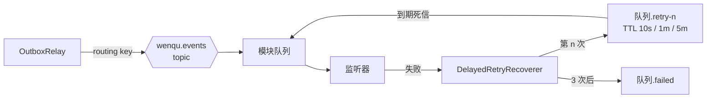

# infra 模块

## 职责

提供与业务无关的技术能力，供业务模块使用：

- 系统健康检查：汇总外部依赖的连接状态。
- 对象存储：基于 S3 协议访问 MinIO，启动时确保存储桶存在。
- 事务性发件箱：业务模块在自己的事务中写入事件，转发到 RabbitMQ。
- 事件消费：事件交换机、各模块的事件队列与延迟重试队列。
- 模型客户端：对话模型与 Embedding 模型的配置。
- OpenAPI 文档配置。

`infra` 只依赖 `common`，不依赖任何业务模块。

## 数据模型

`infra.outbox_event`：

| 列 | 说明 |
|---|---|
| `routing_key` | RabbitMQ 路由键，如 `document.content-changed` |
| `payload` | 事件 JSON |
| `dedup_key` | 防抖键，未投递的事件中唯一 |
| `available_at` | 最早投递时间 |
| `published_at` | 投递成功时间，为空表示未投递 |

| 索引 | 服务的查询 |
|---|---|
| `idx_outbox_event_available_at`（部分索引：未投递） | 转发器读取到期事件 |
| `uk_outbox_event_dedup_key`（部分唯一索引：未投递） | 防抖合并 |
| `idx_outbox_event_published_at`（部分索引：已投递） | 清理旧事件 |

## 对外接口

### HTTP 接口

| 方法 | 路径 | 说明 | 所需角色 |
|---|---|---|---|
| GET | `/api/system/health` | 系统整体状态及每个依赖的连接状态 | 无需登录 |

响应 `data`：

```json
{
  "status": "UP",
  "components": [
    { "name": "db", "status": "UP" },
    { "name": "objectStorage", "status": "UP" },
    { "name": "rabbit", "status": "UP" },
    { "name": "redis", "status": "UP" }
  ]
}
```

- `status` 取值 `UP`、`DOWN`、`OUT_OF_SERVICE`、`UNKNOWN`；任一依赖不可用时整体为 `DOWN`。
- 依赖不可用不影响接口本身的 HTTP 状态，接口始终返回 200，由 `status` 表达结果。

## 核心流程

### 健康检查

`SystemHealthService` 调用 Actuator 的 `HealthEndpoint`，把各健康指标转换为领域对象 `SystemHealth`。参与汇总的指标只有外部依赖：

| 组件 | 来源 |
|---|---|
| `db` | Spring Boot 内置（数据源） |
| `redis` | Spring Boot 内置（Spring Data Redis） |
| `rabbit` | Spring Boot 内置（Spring AMQP） |
| `objectStorage` | `ObjectStorageHealthIndicator`：对存储桶执行 `HeadBucket` |

磁盘空间、ping、SSL、存活与就绪探针等进程自身的指标在配置中关闭。

### 对象存储

- `StorageConfiguration` 创建 `S3Client`：path-style 访问，单次调用超时 5 秒。
- `BucketInitializer` 在应用启动时检查存储桶，不存在则创建。
- `ObjectStorage` 提供上传、读取、删除，以及浏览器可访问的签名链接；下载链接通过 `response-content-disposition` 指定保存的文件名。

### 事务性发件箱

设计见 [0006](../_decisions/0006-跨模块事件使用事务性发件箱.md)。

- `OutboxPublisher.publish(routingKey, payload)`：必须在调用方的事务中调用（`Propagation.MANDATORY`）。
- `OutboxPublisher.publishDebounced(routingKey, payload, dedupKey, delay)`：同一 `dedupKey` 尚未投递的事件合并为一条（`insert ... on conflict ... do update`），保留最新 payload，投递时间推迟到 `delay` 之后。
- `OutboxRelay` 每秒轮询：在事务中用 `select ... for update skip locked` 锁定最多 100 条到期事件，逐条发送到 `wenqu.events` 交换机并等待 broker 确认，确认后标记为已投递。发送后、提交前崩溃会导致重复投递，不会丢失。
- 已投递 7 天的事件在每天 03:30 清理。

### 事件消费与延迟重试



- 模块把订阅声明为 `EventQueue(name, routingKeys)` Bean，`MessagingConfiguration` 为每个队列创建持久化队列、绑定、三个延迟重试队列和一个 failed 队列。
- 监听器抛出异常时，`DelayedRetryRecoverer` 把消息转入下一级重试队列（消息头 `x-wenqu-retries` 记录次数），等待 broker 确认后才确认原消息；重试用尽后转入 `<name>.failed` 保留。需要在用尽时记录业务状态的消费者通过 `EventQueue.isLastAttempt(retries)` 自行处理（如索引任务标记失败）。
- 消息为 JSON，按监听方法的参数类型反序列化；每个消费者一次取一条（`prefetch: 1`）。

### 模型客户端

`AiConfiguration` 用 `wenqu.ai.*` 配置创建 Spring AI 的 `OpenAiChatModel` 与 `OpenAiEmbeddingModel`，见 [0004](../_decisions/0004-AI接入使用SpringAI与OpenAI兼容接口.md)。对话模型与 Embedding 模型各自配置地址、API Key、模型名，可以来自不同的服务；客户端只重试一次，失败由调用方处理。

- `TextEmbedder`：批量向量化，校验返回的向量数量与维度，提供当前模型名。
- `EmbeddingDimensionsCheck`：启动时试算一条文本，返回的维度与 `AI_EMBEDDING_DIMENSIONS` 不一致时启动失败；模型服务不可用时只记录警告。
- 业务模块的对话直接使用 Spring AI 的 `ChatModel` 接口。

## 依赖

| 依赖 | 配置 |
|---|---|
| PostgreSQL | `DB_*` |
| Redis | `REDIS_*` |
| RabbitMQ | `RABBITMQ_*` |
| MinIO | `MINIO_*`（`wenqu.storage.*`） |
| 对话模型 | `AI_CHAT_*`（`wenqu.ai.chat.*`） |
| Embedding 模型 | `AI_EMBEDDING_*`（`wenqu.ai.embedding.*`） |
