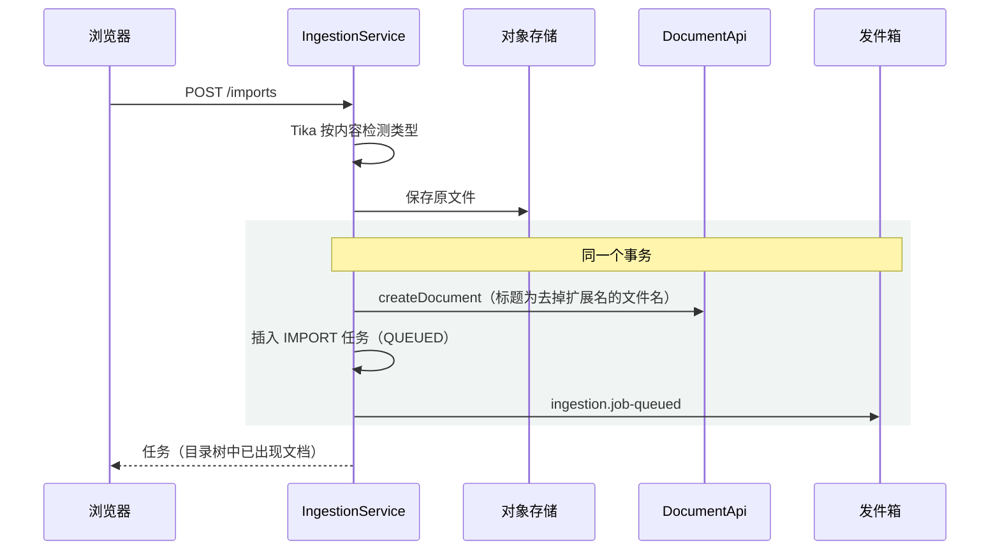

# ingestion 模块

## 职责

- 导入文件：PDF、Word（.docx、.doc）、Markdown、纯文本，单个不超过 20MB。上传后立即在目录树中创建同名文档，原文件存入对象存储，后台解析后写入文档正文。
- 索引任务：把文档正文切块，交给 retrieval 向量化并替换文本块。任务来源有三种：导入文件、编辑器保存正文、管理员重新索引全部文档。
- 任务状态与进度、失败重试、原文件下载。

导入的文件成为普通文档：AI 回答的原文跳转与高亮、后续编辑和重新索引，与手写文档走同一套逻辑。

## 数据模型

`ingestion.ingest_job`：

| 列 | 说明 |
|---|---|
| `workspace_id`、`document_id` | 冗余自 document，见 [0005](../_decisions/0005-每个模块独立schema.md) |
| `trigger` | `IMPORT` 导入文件、`EDIT` 编辑后重新索引、`REINDEX` 管理员重新索引 |
| `status` | `QUEUED`、`PARSING`、`EMBEDDING`、`SUCCEEDED`、`FAILED` |
| `file_name`、`file_size`、`media_type`、`object_key` | 导入的原文件，只有 `IMPORT` 任务有（检查约束） |
| `parsed_at` | 原文件已解析并写入正文，重试时跳过解析 |
| `chunk_count`、`embedded_count` | 文本块总数与已向量化数量，用于展示进度 |
| `attempts` | 已开始处理的次数 |
| `error_message` | 失败原因；`QUEUED` 状态下为上次失败的原因（等待重试） |

| 索引 | 服务的查询 |
|---|---|
| `idx_ingest_job_workspace_id`（部分索引：`IMPORT`） | 导入列表 |
| `idx_ingest_job_workspace_id_document_id` | 每篇文档最近一次任务、文档是否有排队任务、原文件下载 |
| `idx_ingest_job_queued`（部分索引：`QUEUED`） | 排队位置 |

任务成功后删除同一文档更早的、已结束的非导入任务；导入任务保留作为导入记录。

## 对外接口

### HTTP 接口

路径前缀 `/api/workspaces/{workspaceId}`：

| 方法 | 路径 | 说明 | 所需角色 |
|---|---|---|---|
| POST | `/imports` | 导入文件（multipart `file`，可选 `parentId`），返回任务 | EDITOR |
| GET | `/imports` | 最近 50 个导入任务、进度与排队位置 | VIEWER |
| POST | `/ingest-jobs/{jobId}/retry` | 重试失败的任务 | EDITOR |
| GET | `/index-status` | 每篇文档最近一次任务中未成功的（处理中、等待重试、失败） | VIEWER |
| POST | `/reindex` | 空间内全部文档重新索引，返回新排队的文档数 | ADMIN |
| GET | `/documents/{nodeId}/source-file` | 导入文档的原文件下载链接（10 分钟有效） | VIEWER |

错误码：

| 错误码 | HTTP | 场景 |
|---|---|---|
| 10013 | 413 | 文件超过 20MB |
| 14001 | 415 | 按内容检测出的类型不是支持的格式 |
| 14002 | 404 | 任务不存在 |
| 14003 | 409 | 重试的任务不是失败状态 |
| 14004 | 404 | 文档不是导入的文件 |

### 模块 API

无。ingestion 订阅的事件见「依赖」。

## 核心流程

### 导入

事务失败时删除已保存的原文件。

### 执行任务

`IngestJobProcessor` 消费 `ingestion.job-queued`（两个消费者并行，每次取一条）：

1. 尝试次数加一；任务已结束（重复投递）时跳过。
2. 导入任务且未解析过：状态 `PARSING`，从对象存储读取原文件解析为块，去掉与文件名相同的开头一级标题，经 `DocumentApi.replaceContent` 写入正文，记录 `parsed_at`。
3. 读取文档正文快照（已删除时任务失败：「文档已删除」）。`EDIT` 任务在正文版本已被索引时直接成功。
4. 切块，状态 `EMBEDDING`，交给 `RetrievalApi.replaceChunks` 向量化（每 32 块回调一次进度）并替换文本块。
5. 状态 `SUCCEEDED`。

每一步都可以重复执行：原文件只解析一次，文本块整体替换，旧版本的索引结果不覆盖新版本（见 [retrieval](retrieval.md)）。

### 解析

| 格式 | 方式 | 得到的块 |
|---|---|---|
| Markdown | commonmark 语法树 | 标题、段落、列表项（嵌套列表展平）、代码块（保留语言）、引用；图片与 HTML 丢弃 |
| 纯文本 | 空行分段 | 段落 |
| PDF、Word | Tika 输出 XHTML，`XhtmlBlockHandler` 转换 | h1～h6 为标题，p 为段落，li 为列表项，pre 为代码，表格每行合并为一段（单元格以「\|」分隔） |

- Markdown 与纯文本先按 UTF-8 解码，不是合法 UTF-8 时按 GB18030。
- PDF 与 Markdown 的排版换行合并：中文之间直接相连，西文之间补空格，行末连字符断开的单词拼合（`LineJoiner`）。
- 非空白字符少于 20 个时任务直接失败（PDF：「未识别到文字，可能是扫描件」）；文件加密或损坏同样直接失败，不重试。解析后正文超过 2MB 时失败。

### 切块

`Chunker`，token 数用 jtokkit（o200k_base）计算，参数 `CHUNK_MAX_TOKENS`（默认 800）、`CHUNK_OVERLAP_TOKENS`（默认 100）：

- 按标题分节，标题不跨块；标题记入标题路径（如「部署 > 回滚」），不计入正文。
- 节内按顶层块累积，不超过上限；超长的块按句子拆开，单句仍超长时按字符数等分。
- 相邻块重叠：上一块末尾不超过重叠上限的整块（或整句）。以整块为单位，保证每个文本块对应的正文块范围（`blockFrom`～`blockTo`）准确，用于原文高亮。
- 向量化的文本在正文前加上文档标题与标题路径，提高召回；文本块本身只保存正文。

### 失败与重试

| 失败类型 | 处理 |
|---|---|
| 文件内容问题（扫描件、加密、损坏、过大）、文档已删除 | 直接 `FAILED`，记录原因 |
| 模型或存储不可用等异常 | 任务回到 `QUEUED` 并记录原因（等待重试），消息依次延迟 10 秒、1 分钟、5 分钟重新投递（见 [infra](infra.md#事件消费与延迟重试)） |
| 重试 3 次仍失败 | 最后一次处理时标记 `FAILED` |

失败的任务可以在导入页手动重试，尝试次数清零重新排队。

### 编辑后重新索引

编辑器保存正文时，document 写入防抖事件 `document.content-changed`，停止编辑 30 秒后投递。ingestion 收到后为文档创建 `EDIT` 任务；文档已有未开始的排队任务时不重复创建（该任务会处理到最新正文）。

### 彻底删除

收到 `document.purged` 后，在事务中删除这些文档的任务，提交后从对象存储删除原文件。

### 前端（`features/ingestion`）

- 导入页 `/w/:workspaceId/import`：选择目标文件夹（按路径显示），拖放或选择多个文件依次上传；任务表格显示类型角标、大小、状态（排队位置、解析中、向量化进度条、已完成块数、失败原因）、打开或重试。有未完成任务时每 2 秒刷新。
- `ImportNotifier`（随侧栏导航常驻）：任务在页面打开期间完成或失败时弹出通知，完成通知带「去提问」。
- `IndexStatusBadge`：目录树文档行末的索引状态，处理中转圈、失败显示警示图标（悬停显示原因）；有处理中的文档时每 3 秒刷新，否则每 30 秒。
- `SourceFileButton`：文档页顶栏的下载原文件按钮，只有导入的文档显示。
- `ReindexSection`：设置页「通用」中的重新索引全部文档，仅管理员可见。
- 这些组件由 `app` 层通过插槽放入 document、workspace 的页面，document 与 workspace 前端模块不依赖 ingestion。

## 依赖

| 依赖 | 用途 |
|---|---|
| workspace `@RequireWorkspaceRole` | 接口访问控制 |
| document `DocumentApi` | 创建文档、写入导入内容、读取正文快照、空间内全部文档 |
| retrieval `RetrievalApi` | 已索引版本、替换文本块 |
| infra `ObjectStorage`、`OutboxPublisher`、`EventQueue` | 原文件、发布任务事件、订阅事件 |
| 订阅 `document.content-changed` | 编辑后重新索引 |
| 订阅 `document.purged` | 删除任务与原文件 |
| Apache Tika（pdf、microsoft 模块）、POI OOXML schema、commonmark、jtokkit | 解析与切块 |
