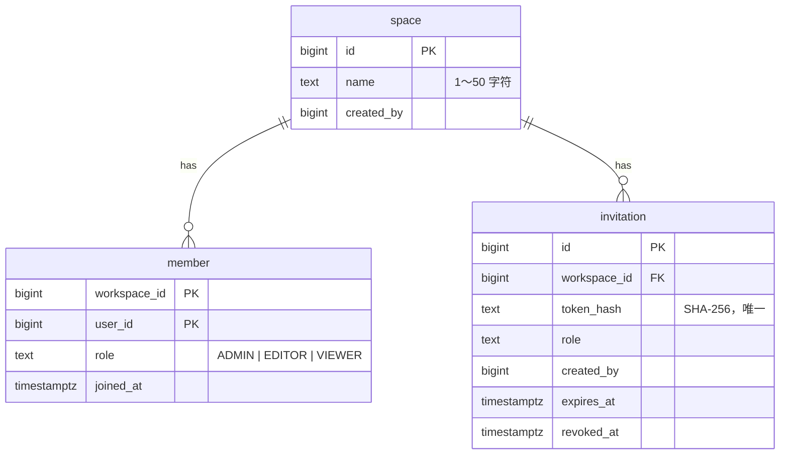
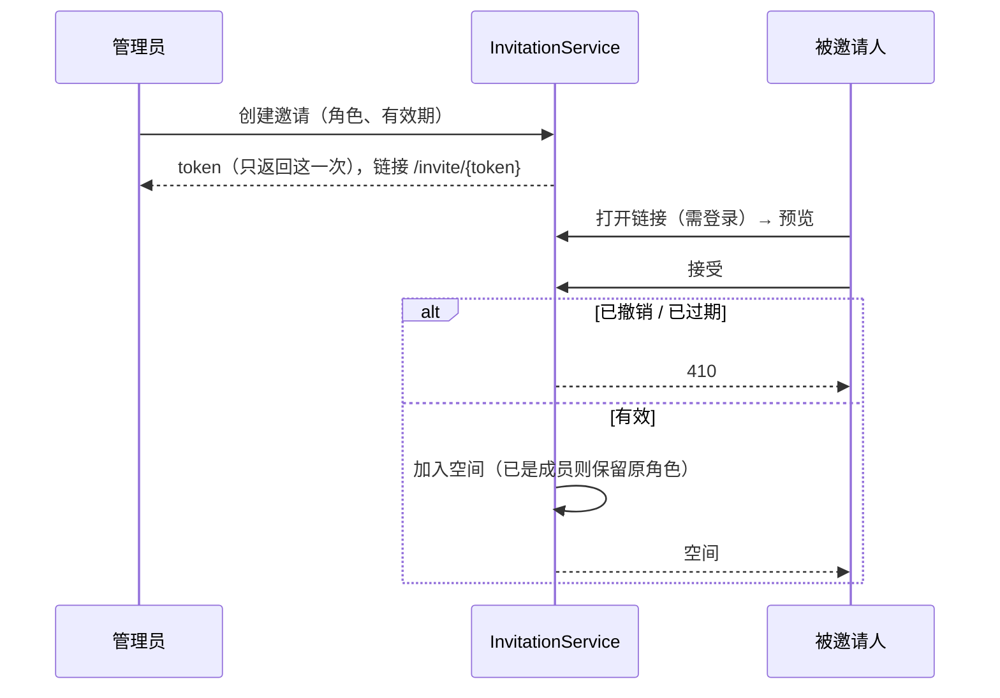

# workspace 模块

## 职责

- 团队空间的创建、重命名、列表。
- 成员与空间级角色：管理员（`ADMIN`）、编辑者（`EDITOR`）、只读成员（`VIEWER`）。
- 邀请链接的创建、撤销与接受。
- 空间内接口的统一访问控制。

## 数据模型

`user_id`、`created_by` 引用 auth 模块的用户，不建跨 schema 外键。

| 索引 | 服务的查询 |
|---|---|
| `member` 主键 `(workspace_id, user_id)` | 每个空间内请求的角色校验 |
| `idx_member_user_id` | 我加入的空间 |
| `uk_invitation_token_hash` | 打开邀请链接 |
| `idx_invitation_workspace_id` | 管理员查看邀请列表 |

## 对外接口

### HTTP 接口

| 方法 | 路径 | 说明 | 所需角色 |
|---|---|---|---|
| POST | `/api/workspaces` | 创建空间，创建者成为管理员 | 登录即可 |
| GET | `/api/workspaces` | 我加入的空间（含我的角色） | 登录即可 |
| GET | `/api/workspaces/{workspaceId}` | 空间详情 | VIEWER |
| PATCH | `/api/workspaces/{workspaceId}` | 重命名 | ADMIN |
| GET | `/api/workspaces/{workspaceId}/members` | 成员列表 | VIEWER |
| POST | `/api/workspaces/{workspaceId}/invitations` | 创建邀请（角色、有效天数 1～30） | ADMIN |
| GET | `/api/workspaces/{workspaceId}/invitations` | 未过期、未撤销的邀请 | ADMIN |
| DELETE | `/api/workspaces/{workspaceId}/invitations/{invitationId}` | 撤销邀请 | ADMIN |
| GET | `/api/invitations/{token}` | 邀请预览 | 登录即可 |
| POST | `/api/invitations/{token}/accept` | 接受邀请，加入空间 | 登录即可 |

错误码：

| 错误码 | HTTP | 场景 |
|---|---|---|
| 12003 | 403 | 角色低于接口要求 |
| 12004 | 404 | 空间不存在或不是成员（不区分，避免暴露空间是否存在） |
| 12010 | 404 | 邀请不存在 |
| 12011 | 410 | 邀请已过期 |
| 12012 | 410 | 邀请已被撤销 |

### 模块 API（`com.wenqu.workspace.api`）

| 类型 | 说明 |
|---|---|
| `WorkspaceRole` | 角色枚举，`includes` 判断角色高低 |
| `@RequireWorkspaceRole` | 标注空间内接口所需的最低角色 |
| `WorkspaceAccessApi.require` | 在 service 中按需校验用户角色 |

## 核心流程

### 空间内接口的访问控制

所有模块中路径含 `{workspaceId}` 的接口（即 `/api/workspaces/{workspaceId}/**`）由 `WorkspaceAccessInterceptor` 统一校验：

1. 读取接口上的 `@RequireWorkspaceRole`；未标注时拒绝请求（500），防止遗漏。
2. 查询当前用户在该空间的角色：不是成员返回 404（12004），角色不足返回 403（12003）。
3. 校验在参数解析与请求体校验之前完成，无权限的请求拿不到任何关于空间的信息。

`WorkspaceAccessCoverageTest` 遍历所有空间内接口，分别以非成员和各角色直接调用，验证上述规则。新增接口自动纳入测试。

### 邀请

- 邀请链接可以被多人使用，直到过期或被撤销。
- 数据库只保存 token 的哈希，管理员无法再次查看链接，需要时重新创建。

### 前端

| 路由 | 页面 |
|---|---|
| `/` | 进入上次访问的空间（记录在 localStorage）；没有空间时跳转创建页 |
| `/workspaces/new` | 创建空间 |
| `/w/:workspaceId` | 空间布局：顶部空间切换器、导航、账号菜单；默认显示概览 |
| `/w/:workspaceId/members` | 成员列表；管理员额外看到邀请链接管理 |
| `/invite/:token` | 邀请落地页，未登录时先登录或注册再回到此页 |

按钮的显示与隐藏只是体验优化，权限以后端校验为准。

## 依赖

| 依赖 | 用途 |
|---|---|
| auth `UserApi` | 成员列表、邀请创建人的昵称 |
| auth `CurrentUserContext` | 拦截器中获取当前用户 |
